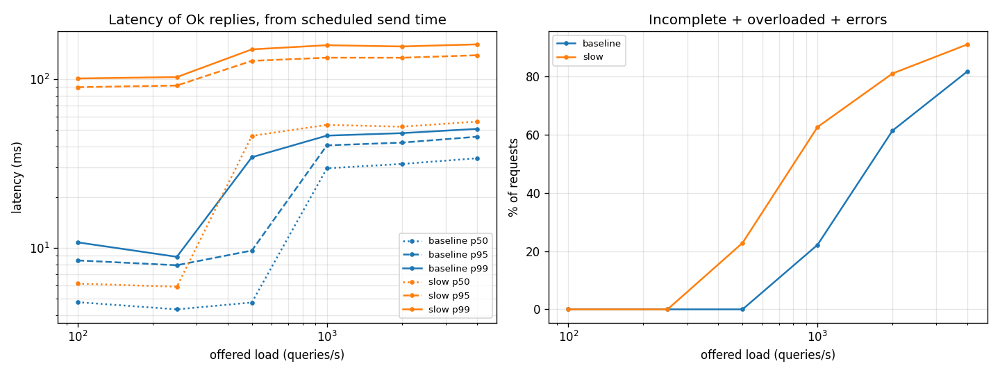

# KRetrieve

[](https://github.com/nglong14/KRetrieve/actions/workflows/ci.yml)

A C++20 BM25 search engine with document shards, a TCP coordinator, deadlines, and bounded queues.

**Core idea:** every shard uses statistics from the *whole corpus*, so its scores are comparable. The coordinator requests each shard's top K and merges them. A complete reply matches the ranking of one unsharded index; a missed shard is reported as an incomplete reply.

## Try it

1. Build and test (C++20, CMake, POSIX; the first test build downloads GoogleTest):

   ```bash
   cmake -S . -B build -DBUILD_TESTING=ON
   cmake --build build -j
   ctest --test-dir build --output-on-failure
   ```

2. Prepare three documents, then start one shard:

   ```bash
   printf '10\tcat cat dog\n20\tdog bird\n30\tcat bird bird\n' > corpus.tsv
   ./build/kretrieve prepare --input corpus.tsv --output prepared --shards 1
   ./build/kretrieve shard --stats prepared/global_stats.bin \
     --partition prepared/shard-0.tsv --port 9000
   ```

3. In another terminal, query it:

   ```bash
   ./build/kretrieve query --port 9000 --k 10 --query "cat dog"
   ```

   Expected document order: **10, 20, 30**. `--port 0` selects and prints a free port.

## How retrieval works

1. `prepare` assigns each document to `document_id % shard_count` and writes `shard-N.tsv` plus `global_stats.bin`. The output directory must not already exist. Preparation holds the corpus in memory; a failed run may leave partial files.
2. Each shard builds an immutable inverted index from its partition. **All shards must load the statistics file from that same preparation run.** The artifacts do not carry a corpus identity check.
3. Search uses BM25 (`k1 = 1.2`, `b = 0.75`) with global document count, document frequency, and average length. Queries match any term; repeated terms count once. Scores sort descending, with document ID ascending on ties.
4. The coordinator sends a query to every shard, then merges their top K. If a shard fails or misses the deadline, its hits are omitted and its position in `--shards` appears in the incomplete result. Optional static replicas recover failed primaries within the same deadline, and with `--hedge-ms` they also cover slow primaries.

Input is one `unsigned_document_id<TAB>text` per line, with unique IDs. Tokenization lowercases ASCII, splits on non-alphanumeric characters, removes built-in English stopwords, and does not stem. Empty text is allowed; an empty corpus is not.

## Run three shards

Use the example `corpus.tsv` above. Start the shards in the background, then run the coordinator:

```bash
./build/kretrieve prepare --input corpus.tsv --output prepared-3 --shards 3
for s in 0 1 2; do
  ./build/kretrieve shard --stats prepared-3/global_stats.bin \
    --partition prepared-3/shard-$s.tsv --port $((9001 + s)) &
done
./build/kretrieve coordinator --port 8000 \
  --shards 127.0.0.1:9001,127.0.0.1:9002,127.0.0.1:9003
```

In another terminal, run `./build/kretrieve query --port 8000 --k 10 --query "cat dog"`.

For crash failover, start one additional shard process per partition with the same `global_stats.bin`, then pass its addresses in matching order with `--replicas host:port,...`. Each primary/replica pair is one logical shard. If a primary connection fails or returns a malformed or non-`Ok` reply, the coordinator tries its replica once with the same request ID and remaining budget. It logs `failover shard=<index> result=<success|failure> failover_ms=<elapsed>` on stderr. If both fail, the logical index appears once in `missing_shards`. Replication is static and covers crash-stop failures; it does not provide automatic discovery, consensus, or protection from mismatched corpus files.

To cut tail latency, add `--hedge-ms <N>` (requires `--replicas`). If a primary has not replied after N ms, the coordinator sends the same request to the replica and uses the first `Ok` reply. It then closes the other connection. Each logical shard gets at most one extra request per query. Every hedge costs one extra search on a replica, and the delay is fixed rather than adaptive. Pick N near the shard's normal p95, and expect hedging to add load when shards are already saturated.

`scripts/chaos.sh` runs three shards with replicas under load, repeatedly `kill -9`s a random shard process and restarts it on the same port, and fails if the coordinator or load generator dies or a sanitizer reports. Set `BIN` to a TSan/ASan build to hunt races (`DURATION`, `QPS`, `INTERVAL`, `DOWN`, `SEED` also apply).

The coordinator's `--budget-us` defaults to 1 second when the client sends 0; the benchmark uses 200 ms. A missing shard still produces an `Ok` reply with a missing-shard list, which the query CLI prints on stderr. Requests that exhaust their budget while queued, or arrive when the worker pool and queue are full, return `Overloaded`.

The Linux server uses epoll for socket I/O and a fixed worker pool for search. Defaults are 64 maximum connections and 16 queued requests. Shards have no authentication or encryption: use loopback or a trusted network. The wire format is defined in [src/protocol.hpp](src/protocol.hpp).

## Benchmarks

The sweep uses a seeded synthetic corpus (100,000 documents), three shards, an 8-worker coordinator with a 16-request queue, and 10 seconds per offered rate. The `slow` run adds 20–100 ms to 10% of searches **on each shard**. The `hedged` run uses the same delays, adds one replica per shard with the same delay settings, and sets `--hedge-ms 10`. All processes run on one machine.

| Run | Offered QPS | p95 of `Ok` replies | p99 of `Ok` replies | Overloaded |
|---|---:|---:|---:|---:|
| Baseline | 250 | 8.07 ms | 8.98 ms | 0% |
| Baseline | 500 | 14.67 ms | 19.38 ms | 0% |
| Baseline | 1,000 | 54.42 ms | 59.82 ms | 40.58% |
| Slow | 100 | 92.22 ms | 103.21 ms | 0% |
| Slow | 250 | 89.15 ms | 103.27 ms | 0% |
| Slow | 500 | 129.12 ms | 151.83 ms | 25.5% |
| Hedged | 100 | 18.61 ms | 53.86 ms | 0% |
| Hedged | 250 | 17.70 ms | 65.20 ms | 0% |
| Hedged | 500 | 84.09 ms | 106.63 ms | 18.84% |

**Read p99 with the overload rate.** The load generator schedules requests at the offered QPS and measures latency from each scheduled time, including client-side wait. Percentiles include only `Ok` replies; overload percentages include *all* requests. At 1,000 offered QPS, baseline serves 5,942 of 10,000 requests. By 4,000 offered QPS, it serves 5,585 and rejects 86.04%: successful throughput has levelled off while rejection grows. The overload point varies between runs on this machine: repeated 1,000 QPS runs of the same build rejected 29–41%.

**Slow shards drive the tail.** A complete query waits for its slowest shard. The injected delay raises p99 even at 100 QPS and causes overload at 500 QPS. These runs show latency and load shedding; they do not measure search relevance or shard-failure recovery.

**Hedging trims the tail.** At 100–250 QPS, hedging cuts p95 from about 90 ms to 18 ms and p99 from 103 ms to 54–65 ms. p99 does not return to baseline: both copies of a shard are slow 1% of the time, so about 3% of queries still hit a slow pair. Past saturation, hedged requests compete with normal ones, so the gain shrinks. Treat the numbers as comparisons for this machine, not production capacity.

**Chaos run.** `DURATION=600 INTERVAL=5 scripts/chaos.sh` ran 10 minutes at 200 QPS with a replica per shard. It `kill -9`'d a random shard process 79 times, restarting each after 1 s. All 120,000 requests returned `Ok` and complete (no incomplete, overloaded or errored replies); p50 4.43 ms, p95 7.41 ms, p99 10.36 ms, max 211.57 ms. The coordinator logged 23,158 failovers, and no process crashed. This ran on a normal build; the TSan build was only run for 15 s, so a long sanitizer run is still open.



Run the sweep and rebuild the chart:

```bash
scripts/bench.sh baseline
scripts/bench.sh slow --latency-ms 20-100 --latency-prob 0.1
HEDGE_MS=10 scripts/bench.sh hedged --latency-ms 20-100 --latency-prob 0.1
python3 -m venv .venv
.venv/bin/pip install -r scripts/requirements.txt
.venv/bin/python scripts/plot.py
```

Results: [bench/summary.csv](bench/summary.csv) and one row per request in `bench/results/` (`seq,due_us,latency_us,status,missing,hits`).

## Build and release notes

CI runs normal, ASan/UBSan, and TSan builds. Use separate build directories with `-DKRETRIEVE_ASAN=ON` or `-DKRETRIEVE_TSAN=ON`; see [CONTRIBUTING.md](CONTRIBUTING.md).

[GitHub Releases](https://github.com/nglong14/KRetrieve/releases) provides the executable archive and `SHA256SUMS`. The initial supported runtime is **Ubuntu 24.04 x86-64** with standard glibc and libstdc++; the C++ library is not packaged as an SDK.
